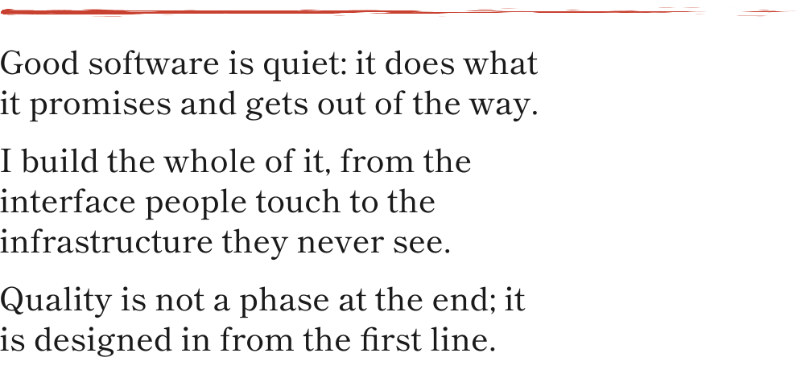

<a href="https://vtitov-portfolio.vercel.app">
  <picture>
    <source media="(max-width: 600px) and (prefers-color-scheme: dark)" srcset="assets/header-dark-narrow.svg">
    <source media="(max-width: 600px)" srcset="assets/header-light-narrow.svg">
    <source media="(prefers-color-scheme: dark)" srcset="assets/header-dark.svg">
    
  </picture>
</a>

 
 

<a href="https://vtitov-portfolio.vercel.app/#manifesto">
  <picture>
    <source media="(max-width: 600px) and (prefers-color-scheme: dark)" srcset="assets/manifesto-dark-narrow.svg">
    <source media="(max-width: 600px)" srcset="assets/manifesto-light-narrow.svg">
    <source media="(prefers-color-scheme: dark)" srcset="assets/manifesto-dark.svg">
    
  </picture>
</a>

I build web products end to end, from the interface to the infrastructure behind it. I run Three Mangos Agency, which designs and builds web products for clients, and develop my own products for AI agents.

Based in Buenos Aires, Argentina. Focused on product development, infrastructure and AI agents.

 

<a href="https://vtitov-portfolio.vercel.app/#projects">
  <picture>
    <source media="(max-width: 600px) and (prefers-color-scheme: dark)" srcset="assets/work-dark-narrow.svg">
    <source media="(max-width: 600px)" srcset="assets/work-light-narrow.svg">
    <source media="(prefers-color-scheme: dark)" srcset="assets/work-dark.svg">
    
  </picture>
</a>

Products <a href="https://vtitov-portfolio.vercel.app/projects/synqel"><b>Synqel</b></a> An open protocol that lets AI agents understand web applications, its TypeScript SDK on npm, and a multi-tenant platform built on top of it.

Agency and client work <a href="https://vtitov-portfolio.vercel.app/projects/three-mangos-agency"><b>Three Mangos Agency</b></a> The digital agency I founded in 2024 to design, build and launch web products for clients.

Quality engineering <a href="https://vtitov-portfolio.vercel.app/projects/osocio-cloud"><b>Osocio Cloud</b></a> A web QA platform for lead-form testing that replaced a Windows desktop tool for a global automotive brand in LATAM.

Side projects <a href="https://vtitov-portfolio.vercel.app/projects/lytur"><b>Lytur</b></a> A web app that turns any screen into party lights that follow the music playing in the room.

[All projects, client sites and side projects](https://vtitov-portfolio.vercel.app/projects)

 

<a href="https://vtitov-portfolio.vercel.app/#stack">
  <picture>
    <source media="(max-width: 600px) and (prefers-color-scheme: dark)" srcset="assets/stack-dark-narrow.svg">
    <source media="(max-width: 600px)" srcset="assets/stack-light-narrow.svg">
    <source media="(prefers-color-scheme: dark)" srcset="assets/stack-dark.svg">
    
  </picture>
</a>

Product engineering TypeScript, React, Next.js, Vite, TanStack, Tailwind CSS, Zod, tRPC, Bun, i18n

Platform and data PostgreSQL, Prisma, Redis, Supabase, Clerk, FastAPI, Swagger, WebSocket, Docker, GitHub Actions, SQL

AI agents MCP, n8n, Whisper

Graphics WebGL, OGL, Three.js, GSAP, Framer Motion

Quality Playwright, Postman, Jira, X-Ray, exploratory testing, shift-left testing

 

<a href="https://vtitov-portfolio.vercel.app/#contact">
  <picture>
    <source media="(max-width: 600px) and (prefers-color-scheme: dark)" srcset="assets/contact-dark-narrow.svg">
    <source media="(max-width: 600px)" srcset="assets/contact-light-narrow.svg">
    <source media="(prefers-color-scheme: dark)" srcset="assets/contact-dark.svg">
    
  </picture>
</a>

Write to me through the [form on my portfolio](https://vtitov-portfolio.vercel.app/#contact), or find me on [LinkedIn](https://linkedin.com/in/vladislavtitov) and [GitHub](https://github.com/vvtitov).
